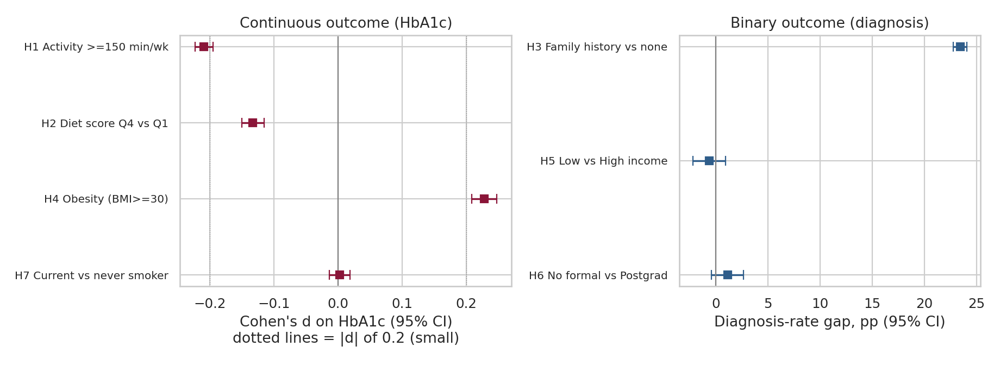
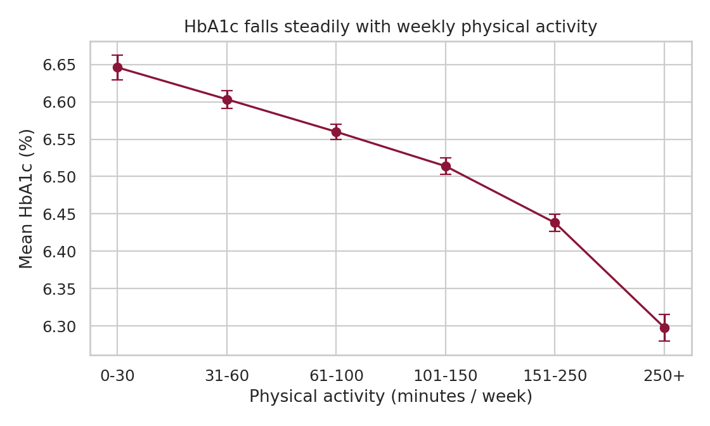
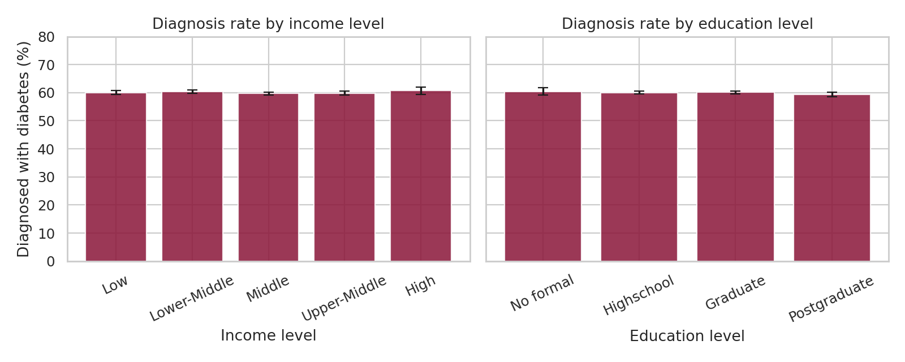
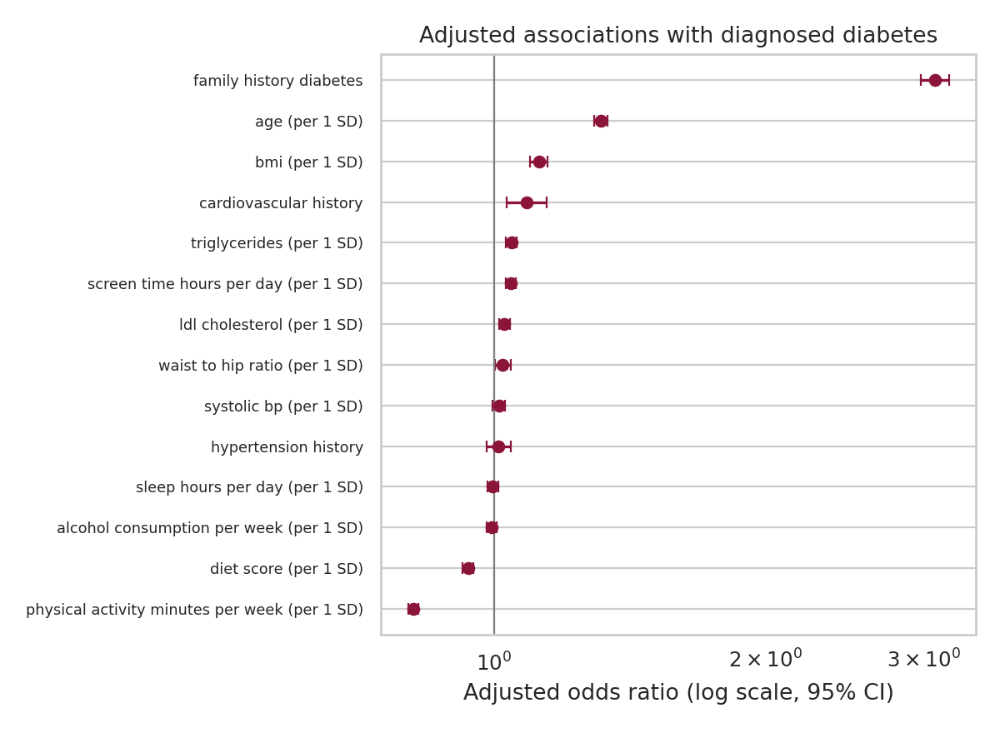
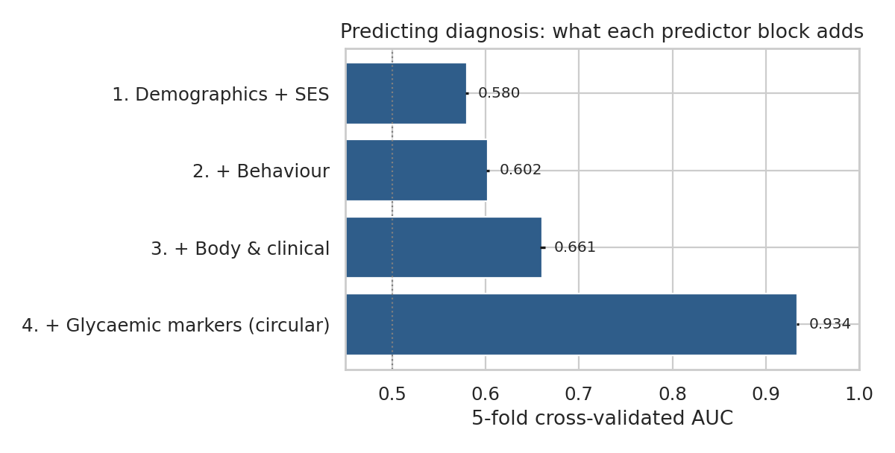

# Lifestyle, Biology, and Socioeconomic Status in Diabetes

**A hypothesis-driven analysis of diabetes risk and blood glucose control.**

This project analyzes 100,000 individual-level records to investigate which behavioural, biological, and socioeconomic factors are associated with HbA1c and diabetes diagnosis.

The focus is on sound statistical practice: pre-specified hypotheses, effect sizes with confidence intervals, correction for multiple testing, equivalence tests for null results, and clear limitations on what observational data can show.

> [!WARNING]
> The dataset appears to be synthetic or simulated: 60% of records are diagnosed, and there is no socioeconomic gradient. Findings describe associations in this file and should not be generalized to real populations. See [Data caveats](#data-caveats).

**Dataset source:** [Diabetes Health Indicators Dataset on Kaggle](https://www.kaggle.com/datasets/mohankrishnathalla/diabetes-health-indicators-dataset). Check the dataset's license before redistributing the data.

## Contents

- [Key findings](#key-findings)
- [Methods](#methods)
- [Data caveats](#data-caveats)
- [Repository structure](#repository-structure)
- [Reproduce the analysis](#reproduce-the-analysis)
- [Possible extensions](#possible-extensions)
- [Author](#author)

## Key findings

| ID | Hypothesis | Result | Effect size (95% CI) |
|:---:|---|---|---|
| H1 | Meeting the WHO activity guideline (150+ min/week) lowers HbA1c | Supported | d = -0.21 (-0.22, -0.20); about 0.17 HbA1c points lower |
| H2 | Top-quartile diet score is linked to lower HbA1c | Supported, small | d = -0.13 (-0.15, -0.12) |
| H3 | Family history raises diagnosis probability | Supported, strong | OR = 2.97 (2.86, 3.07); +23 pp |
| H4 | Obesity (BMI 30+) is linked to higher HbA1c | Supported, small | d = 0.23 (0.21, 0.25) |
| H5 | Diagnosis rate differs by income | Not supported | Cramer's V = 0.007 |
| H6 | Diagnosis rate differs by education | Not supported | Cramer's V = 0.006 |
| H7 | Smokers differ from never-smokers in HbA1c | Not supported | d = 0.002 |

All p-values are two-sided and Holm-corrected across the seven tests. H5-H7 also pass **equivalence tests** (TOST): income and education gaps are demonstrably within +/- 3 percentage points, and the smoking gap is within +/- 0.10 HbA1c points.

### Additional results

- **Dose-response:** Mean HbA1c falls steadily from about 6.65% (0-30 min/week) to about 6.30% (250+ min/week).
- **Adjusted model:** With HbA1c, glucose, and insulin excluded because they define diagnosis, family history (OR about 3.1), age (1.32 per SD), BMI (1.12 per SD), and activity (0.81 per SD) dominate. SES, smoking, and ethnicity are all close to 1.
- **Predictability:** Cross-validated AUC is 0.58 (demographics + SES), 0.60 (+ behaviour), and 0.66 (+ body and clinical). It reaches 0.93 only when glycaemic markers are added, which is circular because they define the outcome.
- **Exploratory:** The activity-HbA1c slope does not differ by income (p = 0.45). A nominal age difference (p = 0.033) would not survive multiplicity correction.

### Visual results

**Effect sizes**



**Activity dose-response**



**Socioeconomic gradient**



**Adjusted odds ratios**



**Predictive performance**



## Methods

| Step | Choice | Reason |
|---|---|---|
| Group comparisons | Welch t-test, Cohen's d with CI | Unequal group sizes and variances; effect size matters more than p at n = 100,000 |
| Categorical outcomes | Chi-square, odds ratio, Cramer's V | Standard for binary diagnosis by group |
| Multiple testing | Holm correction across H1-H7 | Controls family-wise error without being as conservative as Bonferroni |
| Null results | TOST equivalence tests with stated margins | "Not significant" is not "no effect"; margins are a judgement call and are stated up front |
| Adjustment | Logistic regression, standardized predictors, robust (HC1) SEs | Comparable ORs per 1 SD |
| Prediction | 5-fold cross-validated AUC, nested predictor blocks | Shows what each domain adds, and exposes circularity |
| Exploratory work | Interaction F-tests, labelled exploratory | Kept separate from the confirmatory family |

## Data caveats

- **Likely synthetic.** A 60% diagnosed prevalence is far above real adult populations, and income, education, smoking, and ethnicity show no relationship with diagnosis, unlike nearly all real epidemiological data.
- **Observational and cross-sectional.** These are associations only; reverse causality and confounding cannot be excluded (for example, diagnosed people may exercise less).
- **Outcome coding.** Pre-diabetes is coded as undiagnosed, and HbA1c only partly aligns with the recorded stage (85% of Type 2 cases have HbA1c of 6.5 or more).
- **Judgement calls.** The 150-minute activity guideline, BMI 30 threshold, and +/- 3 percentage-point equivalence margin are conventional or stated in advance, not tuned to the data.

## Repository structure

```text
.
├── README.md
├── requirements.txt
├── LICENSE
├── data/
│   ├── README.md                     # Data dictionary and provenance
│   └── raw/diabetes_dataset.csv
├── notebooks/
│   └── 01_hypothesis_testing.ipynb   # Narrated analysis with executed outputs
├── src/
│   ├── analysis_utils.py             # Effect sizes, tests, TOST, Holm
│   ├── hypotheses.py                 # Hypothesis definitions and models
│   └── run_analysis.py               # Regenerates tables and figures
└── results/
    ├── tables/                       # CSV outputs
    └── figures/                      # PNG outputs
```

## Reproduce the analysis

Clone the repository and install the dependencies:

```bash
git clone https://github.com/AneriRaval11/diabetes-hypothesis-testing.git
cd diabetes-hypothesis-testing
python -m venv .venv
```

Activate the virtual environment:

```bash
# macOS/Linux
source .venv/bin/activate

# Windows PowerShell
.\.venv\Scripts\Activate.ps1
```

Install dependencies and run the analysis:

```bash
pip install -r requirements.txt
python src/run_analysis.py
jupyter notebook notebooks/01_hypothesis_testing.ipynb
```

The script writes tables to `results/tables` and figures to `results/figures`. It runs in well under a minute. The random seed is fixed at 42 for cross-validation.

## Possible extensions

- Replace this file with a nationally representative survey (e.g., NHANES) and test whether the SES null results hold.
- Move from association toward causal estimates using quasi-experimental variation.
- Pre-register subgroup analyses (age, sex) and fit interaction models with correction.

## Author

Aneri Raval · [ahraval11@gmail.com](mailto:ahraval11@gmail.com) · [MIT License](LICENSE)
